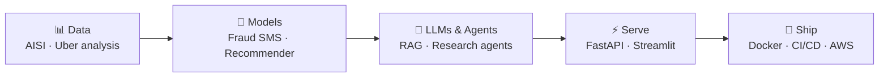

<!-- Typing animation -->
<div align="center">

[](https://git.io/typing-svg)

</div>

---


## 🧑‍💻 About Me

B.Tech student in **Artificial Intelligence & Data Science**, passionate about building practical AI solutions that solve real problems.

- 🔭 Currently working on **ML projects, AI-powered apps with Python**
- 🌱 Deepening my knowledge in **Deep Learning, NLP & LLM-based systems**
- 🤝 Open to collaborate on **Data Science, AI/ML research & open-source projects**
- 💬 Ask me about **Python · Machine Learning · LangChain · RAG · College AI/DS projects**
- ⚡ Fun fact: I enjoy turning complex concepts into simple explanations and real projects

---

## 🚀 Featured Projects

| Project | Description | Tech |
|---|---|---|
| [Vehicle Insurance MLOps Pipeline](https://github.com/mohitmalviya0707/MLOps-ML-complete-pipeline-) | End-to-end MLOps system for vehicle insurance interest prediction | Python · AWS · Docker |
| [RAG-Project](https://github.com/mohitmalviya0707/RAG-Project) | Retrieval-Augmented Generation system | Python · LangChain · RAG |
| [AI Agent Tour](https://github.com/mohitmalviya0707/Ai-agent-tour) | Autonomous AI travel planner | Python · LLM · Agents |
| [Fraud SMS Detector](https://github.com/mohitmalviya0707/Fraud-SMS-detector) | NLP spam detection | Python · NLP · ML |
| [AISI – UIDAI Hackathon](https://github.com/mohitmalviya0707/AISI-UIDAI-2026) | Aadhaar Inclusion Stress Index | Python · Data Analysis |
| [MLOps-Project-01](https://github.com/mohitmalviya0707/MLOps-Project-01) | ML pipeline with MLOps workflow | Python · MLOps |

---

## 🛠️ Tech Stack
**Core:**    

**ML / DL:**    

**GenAI:**    

**Data:**      

**Deploy:**     

**Tools:**     

---

## 📊 GitHub Stats

<div align="center">


</div>
---

⭐ **Thanks for visiting — if you like what you see, consider giving a star!**


<div align="center">

[](https://git.io/typing-svg)

**I take ML ideas past the notebook: data → model → API → deployed pipeline.**


</div>

---

## 🪪 Model Card: `mohit-malviya`

Every ML model ships with a model card. Here is mine.

```yaml
name: Mohit Malviya
base: B.Tech, Artificial Intelligence & Data Science
trained_on: [Python, SQL, scikit-learn, LangChain, FastAPI, Docker, AWS]
fine_tuning_now: [Deep Learning, NLP, agentic LLM systems]

strengths:
  - turning a notebook experiment into a reproducible, deployed pipeline
  - RAG and multi-agent systems over real documents, audio and web data
  - explaining complex ideas in simple words

known_limitations: still in training, so every repo here is a checkpoint, not the final weights
intended_use: AI / ML / Data Science internships, hackathons, open-source collaboration
```

---

## ⏱️ Only have 60 seconds? Start here

| | Project | Why it is worth your click |
|---|---|---|
| 🎙️ | [**AI Meeting Assistant**](https://github.com/mohitmalviya0707/Otter.Ai) | Audio or YouTube link in, transcript, summary, action items and a chat-with-your-meeting RAG out. Whisper + Mistral + ChromaDB. |
| 🚗 | [**Vehicle Insurance MLOps**](https://github.com/mohitmalviya0707/MLOps-Project-01) | A full production path: MongoDB ingestion, validation, training, Flask API, Docker, and GitHub Actions CI/CD to AWS (ECR, EC2, S3). |
| 💸 | [**AI Revenue Recovery Agent**](https://github.com/mohitmalviya0707/ai-revenue-recovery-agent) | A safety-first agent that ranks failed payments by value and recovery probability, applies guardrails, and logs every decision for audit. |

---

## 🧭 How my work fits together



---

## 🚀 Projects

### 🤖 LLMs, RAG & Agents

| Project | What it does | Built with |
|---|---|---|
| [AI Meeting Assistant](https://github.com/mohitmalviya0707/Otter.Ai) | Transcribes meetings and videos, then extracts summaries, action items, key decisions and answers questions over the transcript | Whisper · LangChain · Mistral · ChromaDB · Streamlit |
| [Multi-Agent Research System](https://github.com/mohitmalviya0707/multi-AI-agent) | Search, scrape, write and critique agents that turn a topic into a scored research report | LangChain · Tavily · BeautifulSoup |
| [AI Tour Guide](https://github.com/mohitmalviya0707/Ai-agent-tour) | A planner, four specialist agents and an orchestrator build a personalised tour, running asynchronously | OpenAI Agents SDK · Pydantic · asyncio |
| [PDF RAG Chatbot](https://github.com/mohitmalviya0707/pdf-rag-chatbot) | Ask questions about any PDF in Hindi or English, with spoken answers | LangChain · Mistral · HuggingFace · ChromaDB · Streamlit |
| [RAG Pipeline](https://github.com/mohitmalviya0707/RAG-Project) | Document loaders, chunking, embeddings, vector store and retrievers, built piece by piece | LangChain · Chroma · FAISS |
| [AI Revenue Recovery Agent](https://github.com/mohitmalviya0707/ai-revenue-recovery-agent) | Closed-loop agent for failed-payment recovery with prioritisation, capacity limits, explainable decisions and audit trails | FastAPI · scikit-learn · Streamlit · Plotly |
| [MediIntake AI](https://github.com/mohitmalviya0707/MediIntake-AI) | Guides a patient through a 5-step clinical history, reads prescriptions with OCR and hands the doctor a structured draft | React · FastAPI · MongoDB · Tesseract |

### ⚙️ MLOps

| Project | What it does | Built with |
|---|---|---|
| [Vehicle Insurance MLOps](https://github.com/mohitmalviya0707/MLOps-Project-01) | End-to-end system predicting customer interest in vehicle insurance, from database to deployed API | scikit-learn · Flask · Docker · GitHub Actions · AWS |
| [DVC ML Pipeline](https://github.com/mohitmalviya0707/MLOps-ML-complete-pipeline-) | Reproducible five-stage pipeline: ingestion, preprocessing, feature engineering, training and evaluation | DVC · scikit-learn |
| [MLflow Experiments](https://github.com/mohitmalviya0707/ML-Flow) · [CI Practice](https://github.com/mohitmalviya0707/continues-intrigetion) | Experiment tracking and continuous integration for ML code | MLflow · GitHub Actions |

### 📊 Data Science & Machine Learning

| Project | What it does | Built with |
|---|---|---|
| [AISI: UIDAI Data Hackathon 2026](https://github.com/mohitmalviya0707/AISI-UIDAI-2026) | Aadhaar Inclusion Stress Index: scores every district as low, medium or high stress from enrolment data | Pandas · Streamlit |
| [Fraud SMS Detector](https://github.com/mohitmalviya0707/Fraud-SMS-detector) | Classifies SMS messages as spam or genuine in a simple web app | NLTK · TF-IDF · scikit-learn · Streamlit |
| [Movie Recommender](https://github.com/mohitmalviya0707/movies-recommender-system) | Content-based recommendations using cosine similarity, with posters from the TMDB API | scikit-learn · Streamlit |
| [Patient Records API](https://github.com/mohitmalviya0707/FastAPI-Project) | CRUD API with validation, sorting and computed fields | FastAPI · Pydantic |

<details>
<summary><b>🧪 More from the lab</b> (deep learning, analysis and practice)</summary>

<br/>

- **Deep learning:** [Cat vs Dog Classifier](https://github.com/mohitmalviya0707/Cat-vs-Dog-Image-Classifier) · [Fruit Classification CNN](https://github.com/mohitmalviya0707/fruit-classification-cnn) · [Next Word Prediction](https://github.com/mohitmalviya0707/next-Word-predict) · [Deep Learning notebooks](https://github.com/mohitmalviya0707/DEEP_learning)
- **Prediction & analysis:** [Heart Disease](https://github.com/mohitmalviya0707/Heart_disease_project) · [Rotten Tomatoes Ratings](https://github.com/mohitmalviya0707/Rotten-Tomatoes-Movies-Rating-Prediction) · [Titanic Survival](https://github.com/mohitmalviya0707/titanic-survival-prediction) · [Uber Data Analysis](https://github.com/mohitmalviya0707/uber-data-analysis) · [Car Price Prediction](https://github.com/mohitmalviya0707/Car-Price-Prediction-)
- **GenAI practice:** [Mood Chatbot](https://github.com/mohitmalviya0707/Gen-Ai) · [News Summariser](https://github.com/mohitmalviya0707/LLM-API-project) · [ML for NLP](https://github.com/mohitmalviya0707/ML-for-NLP)
- **Fundamentals:** [SQL Problems](https://github.com/mohitmalviya0707/SQL-problem-) · [MLOps Roadmap](https://github.com/mohitmalviya0707/MLops-Roadmap-)
- **Hackathon builds:** [SmartVenue stadium app](https://github.com/mohitmalviya0707/stadium-flow-winner) · [Adivasi Samaj Sahayata](https://github.com/mohitmalviya0707/adivasi-samaj-sahayata)

</details>

---

## 🛠️ Tech Stack

**Core:**    

**ML / DL:**     

**GenAI:**        

**Data:**      

**MLOps & Deploy:**         

**Tools:**   

---

## 📊 GitHub Stats

<div align="center">


</div>

---

## 🤝 Let's talk

I am looking for an **AI / ML / Data Science internship** where I can ship real features and learn from people better than me. Happy to walk through any project above, including the parts that did not work the first time.

<!-- Fill these in, then delete this comment line and the one below to show the links.
[](https://www.linkedin.com/in/YOUR-LINKEDIN-ID) [](mailto:YOUR-EMAIL)
-->

<div align="center">

⭐ **Thanks for visiting. If something here was useful, a star helps a student get noticed.**

</div>
